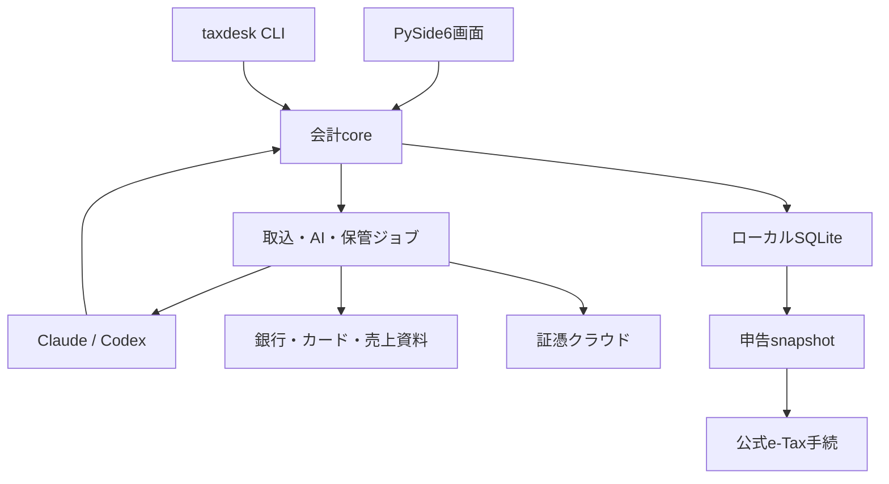

# TaxDesk 詳細設計書

版1.0 / 2026-10-23。Windows 11・Python 3.13（uv）・PySide6・SQLite。製品名TaxDeskは仮称です。

## 設計の中心

毎日の仕訳、銀行CSV、カード自動取得、5サービスの売上、撮影レシート、原本クラウド、帳簿・決算・申告を、同じ会計基盤につなぎます。

アプリがclaude -p / codex execを呼び、Claudeによる画像読取り、制度変更の調査、申告準備の点検を行います。外部AIからtaxdesk CLIを操作する方向も用意します。金額計算・会計不変条件はPython、AIは抽出・提案・説明を担当します。

「クラウドソーシング」はクラウドワークスに確定。対象サービスはランサーズ、ココナラ、MENTA、クラウドワークス、noteです。スマホ専用アプリは将来とし、初期は撮影済み画像をPCへ渡します。

## 構成

coreが唯一のDB writerです。確定仕訳は不変、訂正は反対と置換、売上と入金は別、年度をまたぐ売掛は同じIDを維持します。証憑は原本と検索索引を分け、AIとcloud保存の成否を個別管理します。

## 章別リンク

| 章 | 文書 | Markdownファイル名 |
|---|---|---|
| 01 | [要件・対象範囲](01_scope_requirements.md) | 01_scope_requirements.md |
| 02 | [全体アーキテクチャ](02_architecture.md) | 02_architecture.md |
| 03 | [SQLiteデータモデル・不変条件](03_data_model.md) | 03_data_model.md |
| 04 | [仕訳・帳簿・消込](04_journal_ledger.md) | 04_journal_ledger.md |
| 05 | [取込共通基盤](05_import_pipeline.md) | 05_import_pipeline.md |
| 06 | [銀行CSV・カード自動取得](06_bank_and_card.md) | 06_bank_and_card.md |
| 07 | [5サービスの売上取込](07_platform_sales.md) | 07_platform_sales.md |
| 08 | [Claudeによるレシート読取り](08_receipt_ocr.md) | 08_receipt_ocr.md |
| 09 | [証憑クラウド・セキュリティ](09_cloud_storage_security.md) | 09_cloud_storage_security.md |
| 10 | [PySide6画面・操作](10_ui_screens.md) | 10_ui_screens.md |
| 11 | [税務・決算・年度繰越](11_tax_and_year_end.md) | 11_tax_and_year_end.md |
| 12 | [e-Tax・申告書出力](12_etax_integration.md) | 12_etax_integration.md |
| 13 | [電子帳簿・電子取引・スキャナ保存](13_evidence_compliance.md) | 13_evidence_compliance.md |
| 14 | [ダッシュボード・帳票](14_dashboard_reports.md) | 14_dashboard_reports.md |
| 15 | [CLI・AI操作権限](15_cli_agent.md) | 15_cli_agent.md |
| 16 | [Windows運用・復元・配布](16_operations_backup_distribution.md) | 16_operations_backup_distribution.md |
| 17 | [試験・受入条件](17_testing_acceptance.md) | 17_testing_acceptance.md |
| 18 | [実装順序・リリース条件](18_implementation_roadmap.md) | 18_implementation_roadmap.md |
| 19 | [出典・設計判断・未確定事項](19_sources_and_decisions.md) | 19_sources_and_decisions.md |
| 20 | [実装エージェントへの引継ぎ](20_ai_implementation_handoff.md) | 20_ai_implementation_handoff.md |
| 21 | [Claude/Codex・制度/申告モニタリング](21_ai_bridge_monitoring.md) | 21_ai_bridge_monitoring.md |

## 読む順番

全体を把握する場合は01→02→21→10→18。実装する場合は03→04→05→15→16→17を先に固定します。確定申告と保存条件は11→12→13を確認してください。

## 添付する仕様データ

receipt_extraction.schema.json、cli_response.schema.json、Claude用固定prompt、架空の抽出結果/CLI応答/汎用銀行CSV、出典URL一覧を配布用データへ含めます。サンプルは実際の銀行・サービスのデータではありません。

設計書ダウンロード画面から、章別Markdown、仕様JSON、サンプル、および全体ZIPを保存できる構成にしています。ファイル出力環境の障害により、この版は文書リンクとブラウザ内のファイル生成で提供します。直接添付のZIPファイルを作成済みとするものではありません。

## 実装前に確認する設定

利用銀行/カード、各社の匿名化実資料、対象申告年と税務区分、CLI認証mode/利用上限、cloud保管先を決めます。未確定の設定は19章に整理し、共通会計基盤の設計を止めず、当該機能の本番化gateとして扱います。

カードAPIは契約・対象カードの実証が必要です。CSV代替を自動取得達成とは表示しません。e-Taxは正式年版の転記支援/E2の公式ソフト引渡しを先に実現し、直接送信を追加段階とします。

## 検証の位置付け

章ごとの保存本文を読戻し、記述の保持を確認しました。配布データはJSON例・ファイル名・相対参照・ZIP構造を確認する対象です。これは完成アプリのWindows動作、税額計算、実API取得、e-Tax送信を検証した意味ではありません。

法令・外部仕様の確認日は2026-10-23。対象年と実際の採用版で再確認し、年版ruleとprofileを公開します。

